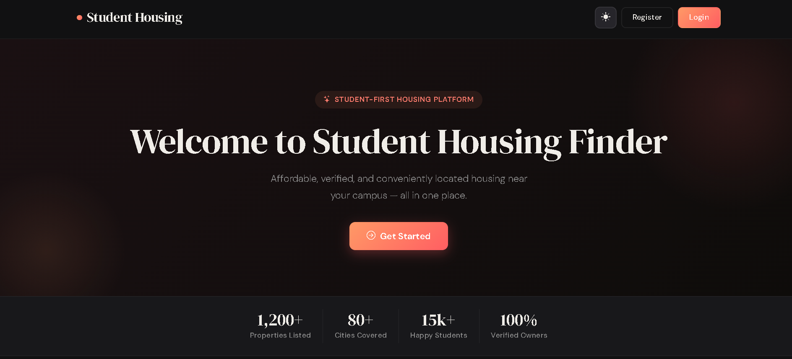
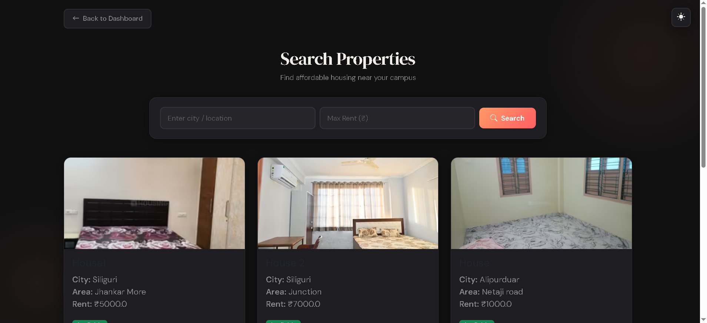
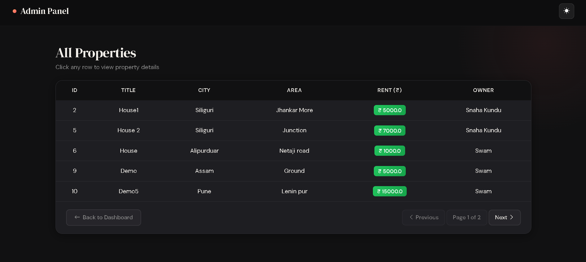
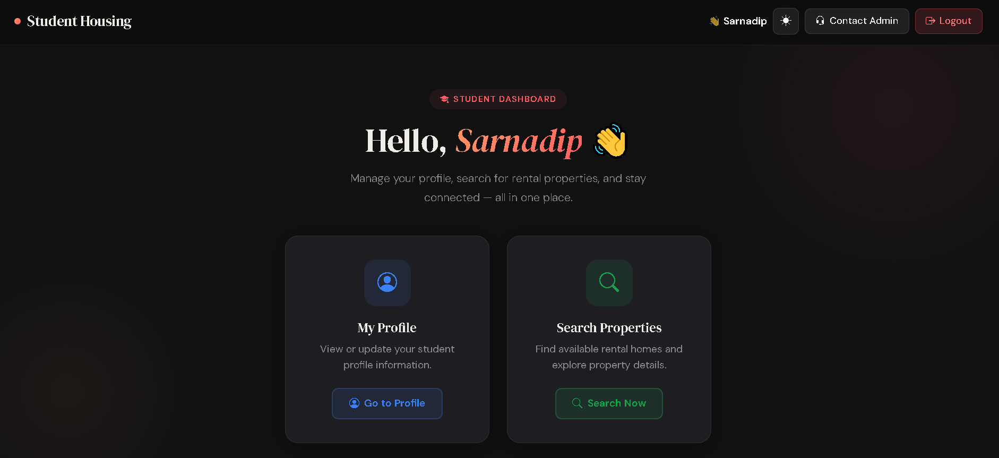
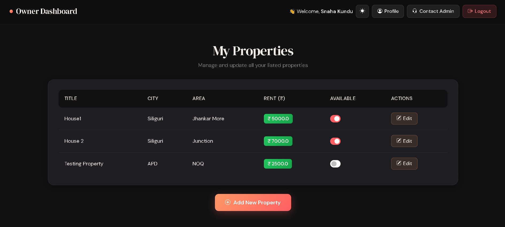
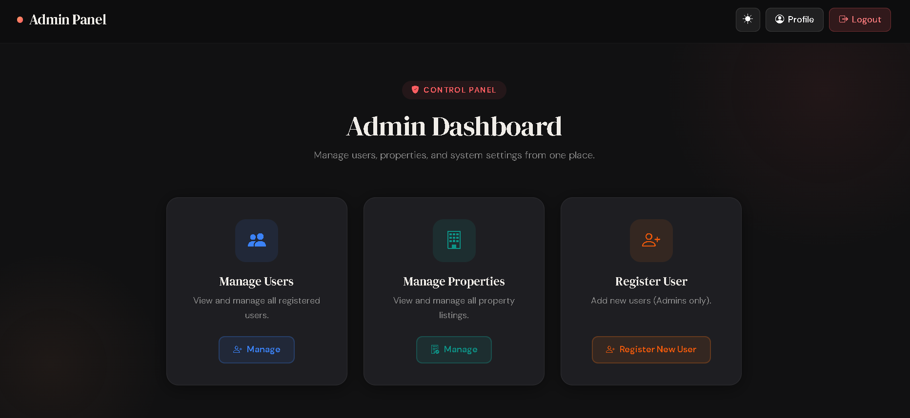

<div align="center">


<h1>Student Housing Management System</h1>
<h3>A web-based platform for students, owners, and administrators</h3>

[](https://www.java.com)
[](https://spring.io/projects/spring-boot)
[](https://neon.tech)
[](https://www.thymeleaf.org)
[](https://cloudinary.com)
[](LICENSE)

*A centralized, secure, and scalable platform for students, property owners, and administrators*

[Features](#-features) · [Tech Stack](#️-tech-stack) · [Screenshots](#️-screenshots) · [Adding Photos](#-adding-photos) · [Setup](#️-running-the-project) · [API Docs](#-pages--routes) · [Author](#-conclusion)

</div>

---

## 📌 Overview

**Student Housing Management System** is a web-based platform built using **Java Spring Boot, Spring Security, Thymeleaf, and PostgreSQL (Neon)**. It enables **students** to search for and book rental properties, **owners** to list, manage, and rent out their properties, and **admins** to manage users and maintain platform integrity.

> No extra app install needed. Works in any browser. Designed for students and property owners alike. Data is stored in the cloud via Neon PostgreSQL — accessible from any machine.

---

## 🚀 Features

<table>
<tr>
<td width="50%">

### 👨‍🎓 Student Features
- 🔐 Secure login & registration (with confirm-password check on the registration forms)
- 👤 Personal profile (ID, email, phone)
- 🔍 Search properties by city, area, max rent, and **rental type (Monthly / Daily / Any)**
- 📍 **Location-based search** — find properties near you using GPS
- 🗺️ Adjustable search radius (2 / 5 / 10 / 20 km)
- 🎯 **Combined search** — "Find Near Me" respects the rental type (Monthly / Daily), max rent, and gender filters, so you can ask for e.g. *daily-rent places within 5 km under ₹800/day*
- 🖼️ View full property details with image carousel
- 🏷️ See at a glance whether a listing is Monthly, Daily, or both
- 📅 **Book a property** with a live availability calendar — pick a date range for daily stays, or a move-in date + duration for monthly stays
- 📑 **My Bookings** — track every booking request (Pending / Confirmed / Cancelled), split by Monthly and Daily
- ↩️ Withdraw a booking request while it's still pending
- 📞 Owner contact info on property page
- 🏠 User-friendly dashboard

</td>
<td width="50%">

### 🏠 Owner Features
- 📝 Register & manage rental properties
- 🏷️ Offer each property for **Monthly rent, Daily rent, or both** independently, with separate pricing for each
- ☁️ Upload multiple images (Cloudinary)
- ✏️ Edit title, city, area, rent(s), rental type(s), description
- 🗑️ Delete individual images from listings
- 🔄 Toggle property availability from dashboard
- 📊 Dashboard with full properties table
- ✅ **Approve or reject booking requests** from students, per property
- 🔔 **Pending-request notification badge** on the My Properties dashboard — see at a glance which properties have requests waiting
- 🚫 Cancel a confirmed booking if needed
- 🌐 **Auto-geocoding** — GPS coordinates saved automatically from city + area on property save
- 🚩 **Send reports to the admin** (service down / maintenance, property issue, booking or tenant dispute, other), optionally linked to one of your properties
- 💬 **Two-way report thread** — answer the admin when they ask for more info, and follow the status New → Under review → Need info → Approved / Rejected
- 🔴 **Unread-reply badge** on the Reports button when the admin has answered

</td>
</tr>
<tr>
<td width="50%">

### 🔑 Admin Features
- 📊 Dashboard cards for Users, Properties, Register User
- 👥 View all registered users (paginated table)
- ✏️ Edit or delete any user
- 🚫 Admins cannot be deleted
- 🏘️ View all properties (paginated table)
- 🚷 Access denied page for unauthorized routes
- 📣 **Notices** — post announcements (Info / Warning / Urgent) for everyone, students only or owners only, with optional auto-hide time
- 📥 **Owner Reports inbox** — filter by status, reply, ask for info, approve or reject, with an unread badge on the dashboard
- 🔁 **One-click "Create notice from this report"** for approved reports (pre-filled, edited by the admin before publishing)

</td>
<td width="50%">

### ⚙️ System Highlights
- 🔐 Role-based access (STUDENT, OWNER, ADMIN)
- 🔄 Custom login redirect per role
- 📅 **Booking system** with an owner-approval workflow (Pending → Confirmed/Cancelled) and double-booking prevention
- ☁️ Cloudinary auto-delete on property removal
- 🌙 Light / dark mode with `localStorage` persistence
- 📱 Bootstrap 5 responsive layout
- 🚫 Custom 403, "Unauthorized," and general error pages
- 🌐 Cloud-hosted database (Neon PostgreSQL)
- 📍 **Smart location search** with GPS + text fallback, combinable with rental type, max rent, and gender filters
- 📣 **Notice banner** at the top of the home page, audience-aware (guests see only "Everyone" notices) and dismissible per browser
- 🧾 **Owner report workflow** with a per-report message thread, status history and unread tracking on both sides

</td>
</tr>
</table>

---

## 🛠️ Tech Stack

### Backend

| Technology | Version | Purpose |
|---|---|---|
| Java | 17 | Core language |
| Spring Boot + MVC | 3.x | REST API & MVC framework |
| Spring Security | 6.x | Role-based access control |
| Spring Data JPA | — | ORM & repository layer |
| PostgreSQL (Neon) | — | Cloud-hosted persistent data storage |
| Cloudinary | — | Image upload & auto-delete |
| OpenStreetMap Nominatim | — | Free geocoding & reverse geocoding (no API key needed) |

### Frontend

| Technology | Purpose |
|---|---|
| Thymeleaf | Server-side templating |
| Bootstrap 5 | Responsive layout & components |
| Animate.css | Entry animations |
| DM Serif Display + DM Sans | Typography (Google Fonts) |
| Browser Geolocation API | Student location detection |
| Vanilla JS calendar widget | Custom-built date-range (daily) and move-in + duration (monthly) booking picker — no external calendar library |

---

## 🎨 UI Design System

All pages share a consistent design system using CSS variables, supporting seamless light/dark theme switching. Theme preference is saved in `localStorage` under the key `sh-theme`.

### Color Palette

| Variable | Light Mode | Dark Mode |
|---|---|---|
| `--accent` | `#FF5E62` | `#FF5E62` |
| `--accent-2` | `#FF9966` | `#FF9966` |
| `--bg` | `#FAF7F4` | `#111112` |
| `--card-bg` | `#FFFFFF` | `#1E1E22` |
| `--text` | `#1A1A1A` | `#F0EDE8` |
| `--text-muted` | `#777777` | `#888888` |
| `--input-bg` | `#F5F2EF` | `#26252A` |

---

## ⚙️ Implementation Details

### 1️⃣ Authentication & Authorization

- Spring Security used for **login, logout, and role-based access control**
- Roles: `ROLE_STUDENT`, `ROLE_OWNER`, `ROLE_ADMIN`
- Custom `LoginSuccessHandler` redirects each role to their respective dashboard on login
- Unauthorized access to protected routes redirects to `/access-denied` instead of the default Whitelabel 403 error
- A separate `UnauthorizedActionException` + `GlobalExceptionHandler` catches ownership-mismatch actions (e.g. an owner trying to view another owner's bookings) and renders a themed **"Unauthorized"** page instead of a raw stack trace

### 2️⃣ File Storage

- Images uploaded to **Cloudinary**
- When properties are deleted, images are also automatically removed from Cloudinary

### 3️⃣ Database — Neon PostgreSQL (Cloud)

- Database is hosted on **Neon** (free tier) — a serverless PostgreSQL platform
- Data is accessible from **any machine** without local setup
- Hibernate auto-creates and manages tables via `ddl-auto=update`
- New columns/tables (rental types, bookings) use `columnDefinition` defaults so schema migrations backfill existing rows safely instead of failing on `NOT NULL` constraints

### 4️⃣ Rental Types & Booking System

Each property can independently offer **Monthly rent, Daily rent, or both**, each with its own price (`monthlyRent`, `dailyRent`, `availableMonthly`, `availableDaily`).

**Booking workflow (owner-approval model):**

- A student picks dates on the property page and submits a **booking request**, which is created with status `PENDING`
- The request already blocks those dates for other students — a property is occupied by at most one active booking (monthly or daily) at a time, regardless of type, so two people can never be approved into overlapping dates
- The **owner** reviews requests on their property's Bookings page and **Approves** (→ `CONFIRMED`) or **Rejects** (→ `CANCELLED`) each one
- A red, pulsing **notification badge** on the owner's My Properties dashboard shows the pending-request count per property
- Students track all their requests on **My Bookings**, split into Monthly and Daily sections, and can **withdraw** a request while it's still pending (not once it's confirmed)

**Calendar UI — different behavior per rental type:**

- **Daily** bookings: click a start day and an end day on a custom calendar widget; booked/past days are greyed out and unclickable
- **Monthly** bookings: click a single move-in date, then choose a duration (1/2/3/6/12 months) from a dropdown — the move-out date is computed automatically (handling month-length edge cases) and checked against existing bookings
- Dates are formatted in local time throughout (never converted through UTC), avoiding the off-by-one-day bugs that timezone-naive date handling commonly introduces

### 5️⃣ Location-Based Property Search

The platform features a **smart two-mode search system**:

**Mode 1 — Manual Search**

- Student enters city/area name, optional max rent, and optional **rental type filter** (Monthly only / Daily only / Any)
- Searches both `city` and `area` fields (case-insensitive, partial match)
- e.g. searching "Salbari" matches a property with `area="Salbari"` even if `city="Sukna"`

**Mode 2 — Find Near Me (GPS)**

- Student clicks "Find Near Me" — browser requests location permission
- Student can choose search radius: 2 / 5 / 10 / 20 km
- **Step 1 (GPS):** Haversine formula query finds properties with stored coordinates within the chosen radius, sorted by distance
- **Step 2 (Fallback):** If no GPS results, reverse geocoding via Nominatim converts the student's coordinates to a city/area name, then falls back to text-based matching
- This ensures results are always returned even when properties don't have GPS coordinates yet

**Combined Search — Near Me + Filters**

Both modes share the same filter set — **rental type** (Monthly / Daily / Any), **max rent**, and **gender preference** — so location and filters can be combined in a single search:

- Filters set in the search bar are sent along with the GPS request: `/properties/nearby?lat=&lng=&radius=&rentalType=&rent=&gender=` (all three filters optional)
- **Max rent is rental-type aware:** with *Monthly* it's compared to the monthly rent, with *Daily* to the daily rent, and with *Any* a property matches if either of its offered rates is within budget (the same rule is now used by manual search, so both modes agree)
- The map pins (`/properties/nearby/map`) use the same filters, and pin popups show the monthly and/or daily price
- While Near Me results are showing, **changing a filter or the radius re-runs the search** for the same location — no need to click Find Near Me again
- The results badge and the Near Me bar show which filters are active
- Property cards now show the Monthly and/or Daily rate, so you can see the rental type at a glance
- The text-match fallback (when no GPS results are found) applies the same filters
- The homepage search and Near Me also have the rental type selector

**Auto-Geocoding on Property Save**

- When an owner saves a property, `GeoCodingService` automatically calls the Nominatim API to convert `city + area` into `latitude` + `longitude`
- Coordinates are stored silently — owners never need to enter GPS data manually
- As more properties are saved, GPS-based search coverage improves automatically

### 6️⃣ Error Handling

- Custom `/access-denied` page for 403 Forbidden errors
- Custom themed **"Unauthorized"** page for ownership-mismatch actions (e.g. editing another owner's property)
- Custom `error-page.html` for general exceptions (e.g., user not found)

### 7️⃣ Responsive UI

- Bootstrap 5 used for responsiveness
- Navbar buttons collapse into a dropdown on smaller screens
- Dark/light theme toggle on every page, synced via `localStorage`
- The booking calendar adapts its layout for mobile; dashboard cards reflow from a grid to a row layout on small screens

---

## 📄 Pages & Routes

| Page | Template | Route | Access |
|---|---|---|---|
| Home | `index.html` | `/` | 🌐 Everyone |
| Login | `login.html` | `/login` | 🌐 Everyone |
| Register | `register-only-user.html` | `/register-user` | 🌐 Everyone |
| Access Denied | `access-denied.html` | `/access-denied` | 🌐 Everyone |
| Unauthorized | `unauthorized.html` | shown on ownership-mismatch actions | 🌐 Everyone |
| Student Dashboard | `student-dashboard.html` | `/student/dashboard` | 🎓 STUDENT |
| Search Properties | `search-properties.html` | `/student-search` | 🎓 STUDENT |
| Search — Manual | `fragments/property-list` | `/search?city=&rent=&rentalType=&gender=` | 🎓 STUDENT |
| Search — Near Me | `fragments/property-list` | `/properties/nearby?lat=&lng=&radius=&rentalType=&rent=&gender=` | 🎓 STUDENT |
| My Bookings | `my-bookings.html` | `/properties/my-bookings` | 🎓 STUDENT |
| Owner Dashboard | `owner-properties.html` | `/properties/owner/{id}` | 🏠 OWNER |
| Add Property | `add-property.html` | `/properties/owner/{id}/add` | 🏠 OWNER |
| Edit Property | `edit-property.html` | `/properties/owner/{id}/edit/{pid}` | 🏠 OWNER |
| Property Bookings | `property-bookings.html` | `/properties/owner/{id}/bookings/{pid}` | 🏠 OWNER |
| Property Details & Booking | `property-details.html` | `/properties/{id}` | 🔒 Auth |
| Book a Property | — | `POST /properties/{id}/book` | 🎓 STUDENT |
| Approve Booking | — | `POST /properties/bookings/{id}/approve` | 🏠 OWNER |
| Reject Booking | — | `POST /properties/bookings/{id}/reject` | 🏠 OWNER |
| Cancel/Withdraw Booking | — | `POST /properties/bookings/{id}/cancel` | 🎓 STUDENT / 🏠 OWNER |
| User Profile | `user-profile.html` | `/profile/{id}` | 🔒 Auth |
| Contact Admin | `admin-profile.html` | `/profile/admin` | 🔒 Auth |
| Admin Dashboard | `admin-dashboard.html` | `/admin/dashboard` | 🔐 ADMIN |
| Manage Users | `manage-users.html` | `/admin/users` | 🔐 ADMIN |
| Manage Properties | `manage-properties.html` | `/admin/properties` | 🔐 ADMIN |
| Edit User | `edit-user.html` | `/admin/users/edit/{id}` | 🔐 ADMIN |
| Notices | `admin-notices.html` | `/admin/notices` (`?fromReport={id}` pre-fills from a report) | 🔐 ADMIN |
| Create / Toggle / Delete Notice | — | `POST /admin/notices`, `/admin/notices/{id}/toggle`, `/admin/notices/{id}/delete` | 🔐 ADMIN |
| Owner Reports inbox | `admin-reports.html` | `/admin/reports?status=` | 🔐 ADMIN |
| Report Thread (admin) | `report-detail.html` | `/admin/reports/{id}` · `POST /admin/reports/{id}/reply` | 🔐 ADMIN |
| My Reports | `owner-reports.html` | `/owner/reports` · `POST /owner/reports` | 🏠 OWNER |
| Report Thread (owner) | `report-detail.html` | `/owner/reports/{id}` · `POST /owner/reports/{id}/reply` | 🏠 OWNER (own reports only) |

---

## 📣 Notices & Owner Reports

Two small modules that let the admin talk to users and let owners talk back.

### 1️⃣ Notices (admin → users)

The admin writes a notice at `/admin/notices`; it appears as a coloured banner under the navbar on the home page.

| Field | Options |
|---|---|
| **Type** | `INFO` (blue), `WARNING` (amber), `URGENT` (red) |
| **Show to** | Everyone (incl. guests), Students only, Owners only — admins see all active notices |
| **Auto-hide at** | Optional date/time; expired notices disappear by themselves |
| **Status** | Live / Off (switch off without deleting) / Expired |

Users can dismiss a banner; this is remembered in that browser only (`localStorage`), and an edited or new notice shows again.

### 2️⃣ Owner reports (owner → admin)

Owners open **Reports** from their dashboard (or *Contact Admin → Send a report*) and choose a type:

`Service down / maintenance` · `Property issue (damage, safety, repairs)` · `Booking or tenant dispute` · `Other`

A report can optionally be linked to one of the owner's properties (stored as id + title, so deleting a property never breaks old reports).

```
        owner sends report
              │
              ▼
            NEW ──admin opens/replies──► UNDER_REVIEW ◄──owner answers──┐
                                              │                          │
                                  admin asks for details                 │
                                              ▼                          │
                                          NEED_INFO ─────────────────────┘
                                              │
                          ┌───────────────────┴──────────────────┐
                          ▼                                      ▼
                      APPROVED                               REJECTED
                          │
              "Create notice from this report"
                          ▼
              pre-filled notice form ──admin edits & publishes──► banner on home page
```

**Rules**
- Every report is a conversation: the owner's description is the first message, then replies from both sides, with status changes shown as chips.
- *Need info* and *Rejected* require a written message from the admin.
- When the owner replies to *Need info*, the report moves back to *Under review*.
- Approved / Rejected reports are closed for owner replies (the admin can still change the status).
- A dot in the lists (and a red count on the dashboard / Reports button) marks unread activity for each side.
- An approved report can be turned into a notice **once**; the owner then receives an automatic "published as a public notice" message. The admin edits the pre-filled text first, so private details are not published by accident.

**Security**
- `/admin/**` is ADMIN-only and `/owner/**` is OWNER-only (`SecurityConfig`).
- Owners can open only their own reports (`ReportService.findForOwnerById` → `UnauthorizedActionException`).
- A linked property must belong to the sender, otherwise the link is ignored.
- All forms are `POST` with CSRF tokens; message lengths are validated server-side (title/subject ≤ 150, text ≤ 2000, notice ≤ 1000).

**Database** — tables are created by Hibernate (`ddl-auto=update`): `notices`, `reports`, `report_messages`. Deleting a user cascades to their reports and messages.

---

## 👥 Roles & Access

| Role | Permissions |
|---|---|
| **Student** | Search properties (manual + GPS, filterable by rental type), view property details, book properties (monthly or daily), track/withdraw booking requests, manage own profile, see notices addressed to students |
| **Owner** | Add/edit/delete own properties, set Monthly/Daily availability and pricing independently, manage listing availability, upload/remove images (coordinates auto-saved), approve/reject/cancel booking requests, send reports to the admin and follow the reply thread |
| **Admin** | Manage all users and properties, register new users (cannot be deleted), publish notices, handle owner reports (reply, request info, approve/reject, turn into a notice) |

---

## 📂 Project Structure

```
STUDENT-HOUSING/
├── assets/                         # Logo + README screenshots
├── src/main/java/com/deep/studenthousing/
│   ├── config/                     # Security, CSRF, login rate-limit, Cloudinary, i18n, admin seeding
│   ├── controller/                 # Home, Login, Register, Student, Property, Booking, Admin, Profile, AdminNotice, AdminReport, OwnerReport
│   ├── dto/                        # PropertyMapDTO (map pins)
│   ├── entity/                     # User, Property, PropertyImage, Booking, Notice, Report, ReportMessage + enums
│   ├── exception/                  # GlobalExceptionHandler, UnauthorizedActionException, ...
│   ├── repository/                 # Spring Data JPA repositories (incl. Haversine query)
│   └── service/                    # Property, Booking, User, GeoCoding, ImageUpload, AccessGuard, Notice, Report
├── src/main/resources/
│   ├── templates/                  # Thymeleaf pages + fragments/
│   ├── static/                     # favicon, logo
│   ├── application.properties
│   └── messages.properties / messages_bn.properties   # English / Bengali
├── env.example                     # Template for your local .env
├── Dockerfile                      # Multi-stage build (Maven -> JRE-alpine)
├── SECURITY-FIXES.md               # Security audit notes
└── pom.xml
```

---

## 🖼️ Screenshots

> Screenshots live in the [`assets/`](assets) folder. To add or replace one, see [Adding Photos](#-adding-photos).

| Home | Property Search |
|:---:|:---:|
|  |  |

| Property Details | Student Dashboard |
|:---:|:---:|
|  |  |

| Owner Dashboard | Admin Dashboard |
|:---:|:---:|
|  |  |

---

## 📸 Adding Photos

There are two kinds of photos in this project: **property photos** (uploaded by owners inside the app) and **README screenshots** (files in the repo).

### 🏠 Property photos (Owners)

Photos are stored on **Cloudinary**, and only the image URLs are saved in the database.

**When creating a listing**

1. Log in as an **Owner** and open **My Properties**.
2. Click **Add Property** and fill in the details.
3. In the **Images** field, choose one or more photos (at least one is required). Selected photos show as previews, and you can remove one before saving.
4. Click **Save**. The photos are uploaded and attached to the listing.

**On an existing listing**

1. Open **My Properties** and click **Edit** on the listing.
2. Use the image field to pick more photos. New photos are **added** to the existing ones, not replaced.
3. To remove a photo, use the delete button on that image. It is removed from the listing and from Cloudinary.

**Upload rules** (enforced on the server in `ImageUploadService`)

| Rule | Limit |
|---|---|
| Allowed formats | JPEG, PNG, WebP, GIF |
| Max size per photo | 10 MB |
| Max photos per upload | 10 |
| Max request size | 50 MB (`spring.servlet.multipart.max-request-size`) |
| Validation | Content-Type **and** the file's first bytes are checked, so renamed non-image files are rejected |

Photos are saved under `student-housing/owner_<ownerId>/property_<propertyId>/` in your Cloudinary account. Students see them in the image carousel on the property page, and the first photo is used on search results and map pins.

**Troubleshooting**

- *Upload fails or shows a 400 page:* the photo is probably over 10 MB, or the total is over 50 MB. Resize it and try again.
- *"Only JPEG, PNG, WebP or GIF images are allowed":* convert the file (for example HEIC to JPEG) and retry.
- *Photos never appear:* check that `CLOUD_NAME`, `API_KEY`, and `API_SECRET` are set correctly (see [Setup](#️-running-the-project)).

### 🖼️ README screenshots (Developers)

1. Take a screenshot of the page (PNG recommended, about 1200 px wide keeps the repo light).
2. Save it in `assets/` with a descriptive snake_case name, e.g. `my_bookings.png`.
3. Add it to the [Screenshots](#️-screenshots) table:

   ```markdown
   |  |
   ```

4. Commit the image together with the README change.

> 💡 Never include real student/owner personal data (names, phone numbers, emails) in screenshots. Use test accounts.

---

## ⚙️ Running the Project

### Prerequisites

- Java 17+
- Maven (or use the included `./mvnw`)
- A PostgreSQL database (e.g. a free [Neon](https://neon.tech) project)
- A free [Cloudinary](https://cloudinary.com) account for image uploads

### 1. Clone

```bash
git clone <your-repo-url>
cd STUDENT-HOUSING
```

### 2. Configure environment variables

Copy the template and fill in real values:

```bash
cp env.example .env
```

| Variable | Description |
|---|---|
| `DB_URL` | JDBC URL, e.g. `jdbc:postgresql://your-host/your-db?sslmode=require` |
| `DB_USERNAME` / `DB_PASSWORD` | Database credentials |
| `CLOUD_NAME` / `API_KEY` / `API_SECRET` | Cloudinary credentials (Settings → Access Keys) |
| `ADMIN_PASSWORD` | Password for the admin account seeded on first start (**required**) |
| `ADMIN_USERNAME` | *(optional)* Admin login email. Defaults to `admin@studenthousing.com` |
| `COOKIE_SECURE` | *(optional)* Set to `true` in production (HTTPS) |
| `PORT` | *(optional)* Defaults to `8080` |

> ⚠️ `.env` is git-ignored. Never commit real secrets.

### 3. Run

```bash
./mvnw spring-boot:run        # Windows: mvnw.cmd spring-boot:run
```

Open <http://localhost:8080>. On first start the admin account is created automatically from `ADMIN_PASSWORD`. Tables are created by Hibernate (`ddl-auto=update`).

### 4. Build a jar

```bash
./mvnw clean package -DskipTests
java -jar target/student-housing-0.0.1-SNAPSHOT.jar
```

### 🐳 Docker

```bash
docker build -t student-housing .
docker run -p 8080:8080 --env-file .env student-housing
```

The Dockerfile uses a multi-stage build (Maven build, then a small JRE-only image). It also works on hosts such as Render, which set `PORT` automatically.

---

## 🌐 Language Support

The UI is available in **English** and **Bengali**. Append `?lang=en` or `?lang=bn` to any URL to switch. Text lives in `messages.properties` and `messages_bn.properties`.

---

## 🔒 Security

- Role-based access (STUDENT / OWNER / ADMIN) with ownership checks on every owner endpoint (`AccessGuard`)
- CSRF protection, HTTP-only and SameSite session cookies, CSP and Referrer-Policy headers
- Login rate limiting (5 failures per 15 minutes per IP + email)
- Server-side image validation (type, size, count, file signature)
- Generic error pages (no stack traces or exception text shown to users)

See [`SECURITY-FIXES.md`](SECURITY-FIXES.md) for the full list of fixes and recommended next steps (rotate any credentials that were ever shared, add SRI to CDN tags, use Flyway/Liquibase in production).

---

## 🏁 Conclusion

The **Student Housing Management System** brings students, owners, and admins onto one secure platform: GPS and filter-based search, monthly and daily rentals with an owner-approval booking flow, cloud image storage, and a responsive light/dark UI.

**Possible future improvements**

- Online payments for bookings
- Reviews and ratings for properties
- Email / SMS notifications for booking updates
- Flyway/Liquibase migrations instead of `ddl-auto=update`

<div align="center">

**Built by Deep** · Made with ☕ and Spring Boot

</div>